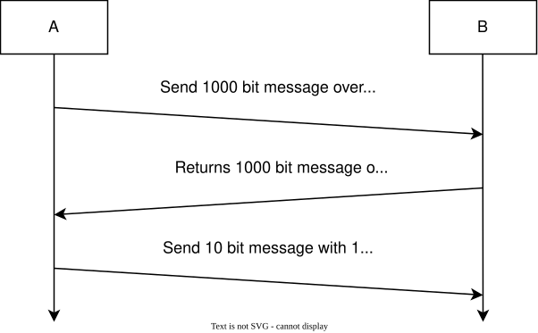
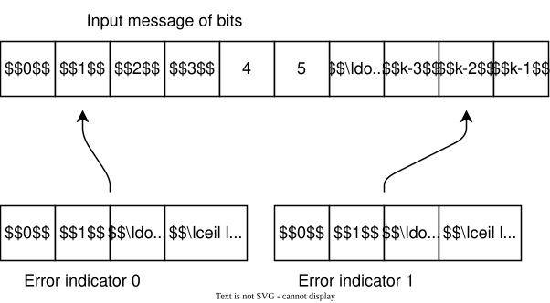

* TOC
{:toc}

# Introduction

I've been interested in error correcting codes (ECC) for a while now, and though I haven't
gotten very far, I keep on reading and, occasionally,
[writing about it](/2022/08/07/Reed-Solomon.html).
Except for really simple schemes, ECC theory gets complicated quickly.

The two codes that I've looked at most are
[Reed-Solomon](https://en.wikipedia.org/wiki/Reed–Solomon_error_correction) (RS)
and binary [Bose–Chaudhuri–Hocquenghem](https://en.wikipedia.org/wiki/BCH_code) (BCH)
codes. They are closely related: both use polynomial math that is normally performed over a
[Galois Field](/2026/06/14/Galois-Field-Arithmetic-Primer.html), though, as shown
in my earlier Reed-Solomon blog post, that's not strictly required. The encoding algorithms
are relatively straightforward but the decoding algorithms are significantly more complicated.

RS and binary BCH codes differ in the size of their symbols, their alphabet: a symbol
of the former consists of multiple bits, often 8 bits, while a symbol of the latter is a bit. 
Errors are corrected with a granularity of a symbol.

One key ECC question is "How many additional bits do I need to correct a given number of errors?"

In this blog post, I check if an intuitive approach that I've been using matches reality.

*I'm trying hard to stay away from theory here, which makes the subject hopefully
more accessible, but has the flip side that it's far from being rigorous and exact.*

# Hamming Distance

When you look at the theory of error detecting and correcting codes, the discussion
immediately turns to [Hamming distance](https://en.wikipedia.org/wiki/Hamming_distance): 
the number of bit flips required to convert one vector of bits to another. The goal of an 
error correcting code is to transform the input vector, the message, to an output vector, 
the codeword, so that the minimum Hamming distance between valid codewords is guaranteed 
to be at least a certain number. The higher the Hamming distance, the higher number of bits 
that can be flipped in a codeword without destroying the ability to recover the original 
message.

If $$t$$[^t_bits] is the number of errors that we want to correct, error coding theory gives 
us the following formula:

$$ d \ge 2 t + 1 $$

[^t_bits]: In literature, you'll often see $$k$$ being used for this formula, but further
           down, $$k$$ is used as the length of the original message, which is also a
           literature convention. So I decided to be consistent within this blog post.

In words: to correct a codeword with a maximum number of $$t$$ bit errors, the Hamming
distance between any 2 codewords must be larger than two times $$t$$.

The theory also tells us the minimum Hamming distance to *detect* an error without correcting
it:

$$ d \ge t + 1 $$

In the rest of this blog post, though, we'll only care about correction, not detection.

Here are 2 quick examples where the message is one bit.

**Adding 1 bit to the message**

For a one bit message, there are only 2 possible messages, 0 and 1. Let's use a code that
repeats this bit once: 0 becomes 00 and 1 becomes 11. The Hamming distance between these 2 
valid codewords is 2 because you need to flip 2 bits to convert 00 into 11. The equation above
tells us that a distance of 2 is not sufficient to fix a one-bit error. Indeed, when we receive 
01 as a codeword, it's impossible to tell if the transmitted codeword was 00 or 11: both
have a Hamming distance of 1 to the received word of 01.

**Adding 2 bits to the message**

When we expand the 1 bit message to 3 bits and repeat the message bit twice, things are different:
0 transforms into 000 and 1 into 111. The Hamming distance between all possible codewords is 3. 
The theory says that we should be able to correct a codeword for which only 1 bit was flipped. 
And indeed, if we receive 001 and there is only 1 bit corrupted, we know for sure that the original 
message was 0. 

# Intuitive Estimation of Error Correction Bits

The concept of a minimum required Hamming distance to correct a number of errors is not particularly 
complicated, but it's a different matter to use it to determine the number of additional ECC bits for,
say, a BCH code. In fact, I still don't know how to do it.

As an alternative, I found myself using a simple model that works like this:

* Participant A transmits 1000 bits to participant B over a noisy channel
* B transmits the same 1000 bits back to A over a perfect channel
* A transmits a 10 bit error index to signal to B which bit it received wrong

Or more general:

If a message of $$k$$ bits has 1 incorrect bit, you need a number of 
$$ r = \lceil \log_2(k) \rceil$$ [^ceil]
bits to point out the incorrect bit. Let's call that number the *error index*[^error_index]. 
To correct $$t$$ bits, you need up to $$ r = t \cdot \lceil \log_2(k) \rceil$$ additional bits.

[^ceil]: $$\lceil x \rceil$$ means: round up to nearest integer.

[^error_index]: I came up with "error index" myself, but it turns out to be a term that is
                commonly used in error coding theory and its meaning is exactly what I
                had in mind!

That's it! The model is simple, it's not exactly practical, and the number of parity bits has 
to be only a first order estimation, but I felt like it had to be pretty close to reality.

But is it?

# Digging Deeper

Let's consider some of the aspects of this model:

**There is no way to signal that there was no corruption**

That can be solved by allocating one error index value extra to signal a perfect
transmission and calculate the number of bits as $$r = \lceil \log_2(k+1) \rceil$$ instead of
$$r =  \lceil \log_2(k) \rceil$$.

E.g. for a 1000-bit message, an error index from 0 to 999 indicates an error location, 
and 1000 signals perfect transmission.

For messages that are not a power of 2, the number of error indicator bits
remains the same.

**The transmitted error indicator bits can be corrupt as well**

One way to solve this is by going through the same procedure to verify the error index.

For a first iteration, it would cost an additional
$$\lceil \log_2(\lceil \log_2(k+1) \rceil ) \rceil $$ bits, 4 bits for a 10 bit error index.
Of course, those 4 bits might be corrupt too!

A better approach is to work backwards: start out with the length of the codeword and the
number of errors you want to correct and determine the number of input message bits from there.

The number of error indicator bits is then calculated over the length of the codeword and
you get $$r = \lceil \log_2(n+1) \rceil$$. The length of the message is $$k = n - r$$.

This breaks the simple model where you transmit message and error indicator separately, but
that was not a realistic scenario anyway.

**It doesn't consider that the same error index can appear only once**

If the code can correct 2 errors, you'd need $$ \lceil \log_2(k+1) \rceil $$ bits for the first
error index to indicate zero errors or the location of the first error. For the second error, you
need one less value because one location has already been corrected, so the number of
bits needed is $$\lceil \log_2(k) \rceil $$.

This suggests that the number of error indicator bits might be an upper bound.

**It only applies to error correction the way BCH does it**

Any random bit can be corrected, but it doesn't work for RS coding because
there a whole symbol can be incorrect. That's fixable though, I get to that later.

**You don't need to signal the correct value**

Since the symbol is 1 bit in size, the location of the error is sufficient. To fix it,
the receiver just needs to invert the bit. This also doesn't work for RS.

# Comparing against BCH Codes

Forget about using the Wikipedia article to compare the intuition against theory: you won't
find anything explicit. I found
[this presentation from the National Taipei University](https://web.ntpu.edu.tw/~yshan/BCH_code.pdf)
useful. The key formulas are on the first slide:

* Block length: $$ n = 2^m -1 $$
* Number of parity-check bits: $$ n - k \le m t $$
* Minimum distance: $$ d_{min} \ge 2t + 1 $$[^bch_hamming]

[^bch_hamming]: This is the minimum Hamming distance equation for error correction.

In the equations above, $$k$$ is still the length of the original message, $$t$$ is the number of bits
that can be corrected, $$n$$ is the length of the codeword.

If we rearrange the first equation, we get:

$$
  m = \log_2(n + 1)
$$

Substitute $$m$$ in the second equation:

$$
n - k \le \log_2(n + 1) t
$$

$$r$$ is the number of error correction bits, so $$r = n - k$$ and:

$$
r \le \log_2(n + 1) t
$$

Compare this with the intuitive formula that I started with:

$$
r \approx \lceil \log_2(k) \rceil t
$$

The only differences are:

* I used $$k$$ instead of $$n+1$$. That accounts for the fact that parity bits themselves
  need error correction too and that a perfect transmission must be signaled.
* the BCH equation assumes that the total codeword length is always one less than a power of two.
* instead of an approximation, it defines an upper bound.

Theoretically, all BCH and RS codewords have a length $$n = 2^m -1$$ symbols. In practice,
the transmitted codewords are often shortened by setting a bunch of the symbols in the input message
to zero and not transmitting them.[^systematic_code] When using shortened codes, you still have
to use the $$m$$ value of the parent code for which $$n = 2^m -1$$.

The intuitive formula works for long codewords and a limited number of errors to correct: $$n \approx k$$.

[^systematic_code]: This assumes that a systematic coding scheme is used, where the original message
                    appears unmodified in the codeword. This is the case for most BCH and RS coding
                    schemes that are used in the real world.

# What about Reed-Solomon Codes?

RS codes correct symbols not bits but you can still use the intuitive formula to identify the
corrupted symbol: in a message with, say, 223 bytes you'd need 8 bits to pinpoint an incorrect byte.
However, you also need an additional byte to fix the corruption and that is the case for every error
byte that needs to be corrected.

To repair $$t$$ symbols that are $$s$$ bits in size in a message of $$k$$ symbols, you'd need this
number of bits for the error location:

$$ r_{location} \approx t \lceil \log_2(k) \rceil $$

And a bunch of bits with the correct values:

$$ r_{values} = t \cdot s $$

*Note that $$r_{location}$$ points to a symbol, not a bit.*

Just like BCH codes, $$n = 2^s - 1$$ for RS codes. Change $$r_{location}$$ to
use $$n$$ instead of $$k$$ and you get:

$$ r_{location} \approx t \cdot \lceil \log_2(2^s -1) \rceil $$

$$ r_{location} \approx t \cdot s $$

The final result is:

$$
r = r_{location} + r_{values} \approx 2 t \cdot s
$$

It turns out, that is *exactly* what you'll find in all texts about RS coding: the number of
parity symbols must be at least 2 times the number of corrupt symbols you want to correct.

# BCH vs Reed-Solomon Codes

I'm getting a bit off-topic here but with the intuitive formula validated, it's interesting
to see when RS codes are better than BCH and vice versa.

Let's create an example where codewords are 255 bytes or 2040 bits and where we reserve 32 bytes or
256 bits for error correction.

For RS, this allows us to correct 16 corrupt bytes that can contain up to 128 corrupt bits, as
long as they're contained within those 16 bytes.
For BCH, we need 11 bits per error or $$11 \cdot 23 = 253$$ parity bits to correct 23 corrupt 
bits which fits within the 256 bits that were allocated for RS.

RS is the winner if errors happen in bursts: it doesn't matter if a burst is 1 or 8 bits long, it
counts as a single corruption when they fall within the same byte. BCH wins when errors are spread randomly:
instead of fixing 16 bit flips, it can fix 23.

In practice, communication protocols often used 2 codes in the following scheme:

* Transmitter: RS Encoder -> Interleaving -> Convolutional Encoder
* Receiver: Viterbi Decoder -> De-interleaving -> RS Decoder

In this setup, RS is called an *outer* code and convolutional coding the *inner* code, because they wrap
around the transmission in that order.

In many transmission mediums, bit error are uncorrelated and burst errors unlikely. One would think that 
RS coding is the wrong choice then. However, the Viterbi decoder can introduce bursts of errors when 
it makes a mistake. The RS decoder is used to clean those up. The burst error length can be so long that 
a single RS codeword can't deal with them. That's why there's an interleaver to increase the length of 
burst errors that can be corrected, at the expense of latency and memory storage, but that's a topic for 
a different blog post.

Modern communication protocols, such as [DVB-S2](https://en.wikipedia.org/wiki/DVB-S2) that's used by 
satellite TV, use a [low density parity check (LDPC) code](https://en.wikipedia.org/wiki/Low-density_parity-check_code) 
instead of a convoluational code as inner code. A LDPC decoder has a lower tendency to introduce
long error bursts in case of a mistake and instead introduces single bit errors that are spread 
randomly within a large codeword. This is where BCH codes shine which is why it's used instead of RS.

*All words in this blog posts were written by a human.*

# References

* [Reed-Solomon Error Correcting Codes from the Bottom Up](/2022/08/07/Reed-Solomon.html)

* [National Taipei University - BCH code](https://web.ntpu.edu.tw/~yshan/BCH_code.pdf)

* [CMU Introduction to Coding Theory - Notes 4: Elementary bounds on codes](https://www.cs.cmu.edu/~venkatg/teaching/codingtheory/notes/notes4.pdf)

* [NASA - Bandwidth efficient CCSDS coding standard proposals](https://ntrs.nasa.gov/citations/19920021465)

  Discusses outer coding/interleaving/inner coding for space communication. There's an abundance of
  information in there, which is what you'd expect from a 70 page document!

# Footnotes

